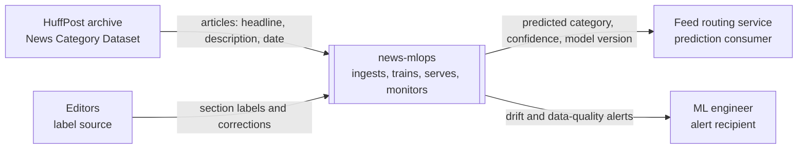
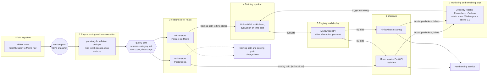
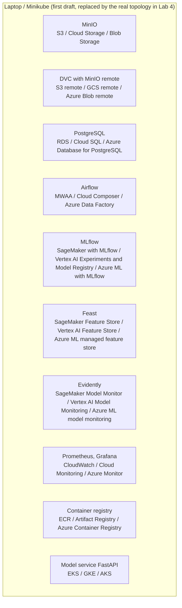

# Design document: dynamic news classification

Status: Lab 1 draft. Follows the ml-design-docs template. Items marked **Assumption** are numbers or decisions I proceed with until a later lab replaces them with evidence.

## 1 Overview

News articles must be routed into editorial categories (politics, wellness, travel and so on) so that feeds and editors can find them. Topics, vocabulary and even the category scheme of a news source change over time, so a classifier trained once degrades. We build a system that ingests articles in monthly batches, trains and validates a text classifier with a time-based split, serves predictions through an API, and monitors for data and prediction drift. The desired outcome is a classifier whose behavior is reproducible from the repository, whose degradation is noticed by a human, and which can be retrained and promoted safely.

## 2 Motivation

- **Who consumes the predictions:** a feed-routing service that places each new article into a section, and editors who review the automatic label. Assumption: the consumer calls the service once per article at publication time, plus a nightly batch for backfills.
- **How often:** new articles arrive continuously; the dataset is replayed as monthly batches of about 2,700 articles (median month in 2012 to 2017, 331 to 2,953 range).
- **What happens when predictions are wrong:** an article lands in the wrong section, an editor overrides it, and trust in automatic routing drops. A silent drop in quality (for example after a change of categories at the source) is worse than a visible error, which is why this needs monitoring, versioned data and a promotion process, not a one-off notebook.

## 3 Success metrics

| Layer | Metric | Target | Role |
|---|---|---|---|
| Business / decision | Editor override rate (share of automatic labels changed by an editor) | at most 25% (Assumption, calibrated after the Lab 2 baseline) | outcome being monitored, lagging |
| Model | Macro-F1 on the 2017 hold-out, 33 classes | at least 0.45 (Assumption, replaced by the measured baseline in Lab 2) | **optimizing** metric |
| System | p95 latency of the prediction endpoint, and batch freshness | p95 at most 200 ms; predictions for a new batch available within 1 hour of arrival (Assumption) | **satisficing** metric |

Accuracy is reported but not optimized, because the classes are imbalanced (POLITICS has about 35,600 rows, EDUCATION about 1,000 across the whole dataset).

## 4 Requirements and constraints

### Functional requirements

- **Input:** one article, as `headline` (text, required) and `short_description` (text, may be empty).
- **Output:** the predicted canonical category (one of 33), a confidence score, and the model version that produced it.
- **Who calls:** the feed-routing service (online, one article per call) and an Airflow batch job (offline, a whole monthly batch).
- **What is returned on failure:** HTTP 503 with a body telling the caller to route the article to the manual queue.

### Non-functional requirements

| Category | Requirement |
|---|---|
| Freshness | Predictions for a monthly batch available within 1 hour of its arrival; a newly promoted model serves traffic within 5 minutes (Assumption). |
| Latency and throughput | p95 at most 200 ms per request; sustained 5 requests per second, peak 10 (Assumption: a mid-size newsroom publishes at most a few thousand articles a day). |
| Availability and fallback | 99% monthly availability on the local stack (Assumption). Fallback: serve the previous model version (registry alias `previous`); if no model is loadable, return 503 and route to the manual queue. |
| Reproducibility | Any registered model can be rebuilt from a git commit and a DVC data version with one command; the same monthly interval run twice gives identical row counts. |
| Adaptability | New data enters as a monthly batch through the Airflow DAG; retraining is triggered by a drift alert or, at the latest, every 3 months (Assumption); a new model enters serving only through a registry alias change after human approval. |
| Observability without ground truth | Track predicted-category distribution, confidence distribution, input length and empty-description rate; alert when the Jensen-Shannon divergence of the predicted-category distribution against the training reference exceeds 0.1 (Assumption). |
| Cost and resource ceilings | Local stack within a 4 GB Minikube cluster; the cloud estimate in 6.7 must stay below 600 USD per month (Assumption). |

### In scope

Single-label classification of English headline plus description into 33 canonical categories; monthly batch ingestion; time-based validation; model registry and promotion; online prediction API; drift monitoring and alerts.

### Out of scope

Scraping full article bodies; multi-label classification; languages other than English; user-level personalization; a real CMS integration (the consumer is simulated); streaming infrastructure (Kafka, Spark).

## 5 Data and techniques

### 5.1 Problem statement

Single-label, multi-class text classification: given a headline and short description, predict one of 33 canonical categories.

**Rejected framing:** multi-label classification. Each article has exactly one editorial category in the data, so multi-label ground truth does not exist, and a multi-label design could not be evaluated.

### 5.2 Data

**Source:** HuffPost News Category Dataset (about 209,500 articles, 2012-01-28 to 2022-09-23, 42 raw categories). Fields: `headline`, `short_description`, `category`, `authors`, `date`, `link`. License to be confirmed on the Kaggle dataset page before submission (Assumption: usable for coursework).

**Arrival pattern:** the file is one static snapshot; I replay it as monthly batches by `date`.

**Used period:** 2012-02 to 2017-12 (about 192,000 rows minus 331 rows of the incomplete January 2012). The archive was collected through a changing website: about 30,000 to 35,000 articles per year in 2012 to 2017, then 9,734 in 2018 and about 2,000 per year after, so later years are too sparse for monthly batches.

**Labels and their delay:** the label is the HuffPost section recorded with each article. Assumption: it is available together with the article (delay of zero); in a real newsroom the corrective label would be an editor override, assumed to arrive within 1 day. The label is an editorial section, not human-verified ground truth, which is a known limit.

**Available at serving time:** `headline`, `short_description`. **Training time only:** `category`, `date` (used for splitting and batching), `authors` and `link`. `authors` is dropped at ingestion (see 6.5).

**Category scheme changes:** from 2014-04-18 the source started using extra categories that overlap older ones and later stopped (for example PARENTS next to PARENTING, HEALTHY LIVING next to WELLNESS, WORLDPOST and THE WORLDPOST before WORLD NEWS appears in 2017-04). Preprocessing maps the 42 raw names to 33 canonical classes with a versioned mapping table:

| Raw category | Canonical category |
|---|---|
| PARENTS | PARENTING |
| HEALTHY LIVING | WELLNESS |
| TASTE | FOOD & DRINK |
| GREEN | ENVIRONMENT |
| STYLE | STYLE & BEAUTY |
| ARTS, ARTS & CULTURE | CULTURE & ARTS |
| WORLDPOST, THE WORLDPOST | WORLD NEWS |

**Checklist justification (step 1):**

1. **Time axis.** Every article has a publication date, so batches are real months, and Lab 2 can ingest "the next month" from 2017 onward. No manufactured batches are needed.
2. **Enough history to hold out a period.** Almost 5 years of dense data for training (2012-02 to 2016-09), 3 months for validation (2016-10 to 2016-12) and the whole of 2017 (29,889 rows) as the hold-out.
3. **Labels with a known arrival delay.** Delay is zero in this dataset (Assumption: up to 1 day in a real newsroom). Lab 4 monitors drift of the prediction distribution first, and uses labels for accuracy only when they arrive; the row for this is in section 4.
4. **A text surface or documented corpus.** The task is text itself. The corpus for the Lab 3 retrieval component is the headlines and descriptions of the same dataset (about 192,000 documents); full article bodies are not scraped (Assumption: avoids terms-of-service issues).

**Known data issues:** 9.4% of rows have an empty `short_description`; 1,531 duplicate headlines. Both are handled in preprocessing (empty text becomes an empty string plus a `has_description` flag; duplicates are removed).

### 5.3 Techniques

**Baseline:** TF-IDF (word 1-2 grams) on headline plus description with logistic regression, class-weighted. Chosen because it is trivial to rebuild and gives the first honest number.

**Candidate:** a frozen sentence-embedding model followed by a linear classification head (Assumption; chosen only if it beats the baseline on validation macro-F1 by a meaningful margin, otherwise the baseline stays in production).

**Features and where each value comes from at serving time:**

| Feature | Serving-time source | Training-time source |
|---|---|---|
| `headline` text | request payload | Feast offline store (Parquet on MinIO) |
| `short_description` text (empty allowed) | request payload | Feast offline store |
| `has_description` flag | computed from the request payload | Feast offline store |
| `headline_len_tokens` | computed from the request payload | Feast offline store |

Excluded on purpose: `authors` (personal data, and a leak-like proxy for category), `date` (used only for splitting, not as a feature), `link` (an identifier, not article content).

### 5.4 Experimentation and validation

- **Split strategy:** by time, never random. Train 2012-02 to 2016-09, validation 2016-10 to 2016-12, test (hold-out) 2017-01 to 2017-12. A random split would let articles about the same event appear on both sides, which leaks the future into training.
- **Offline metric:** macro-F1 (optimizing), with per-class F1 and accuracy reported alongside.
- **Comparing a new model with the current one:** both are evaluated on the same most recent hold-out window; the new model is promoted only if macro-F1 is higher by at least 0.01 and no class with more than 1,000 test rows loses more than 0.05 F1 (Assumption).

### 5.5 Human in the loop

- **Drift alert:** reviewed by the ML engineer (the project owner), who decides within 2 working days whether to retrain.
- **Model promotion:** approved by the model owner (the project owner) after reading the comparison report in MLflow; nothing is promoted automatically.
- **Override:** an editor changes the category in the (simulated) CMS; the correction is stored with the article and the original prediction, and enters the next training batch as a label.

## 6 System design

### 6.1 High-level design

#### System context

#### Data flow on the seven layers

All seven layers are used. The feature store layer is thin (cleaned text and a few derived fields) and is kept because it gives one place where training and serving values are defined; it is the point where training-serving skew could enter.

#### Deployment, first draft

### 6.2 Infra

The local stack runs on one laptop (Minikube with the docker driver, 4 GB). Every component below appears in the diagrams under the same name.

| Component | Local | AWS | GCP | Azure |
|---|---|---|---|---|
| MinIO (object storage, data lake) | MinIO-compatible `pgsty/silo` image | Amazon S3 | Cloud Storage | Blob Storage |
| DVC (data versioning, remote on MinIO) | DVC with dvc-s3 | S3 remote | GCS remote | Azure Blob remote |
| PostgreSQL (warehouse, Feast online store) | PostgreSQL 16 | Amazon RDS | Cloud SQL | Azure Database for PostgreSQL |
| Airflow (orchestrator) | Apache Airflow, LocalExecutor | Amazon MWAA | Cloud Composer | Azure Data Factory |
| MLflow (tracking and registry) | MLflow, PostgreSQL backend, MinIO artifacts | SageMaker with MLflow | Vertex AI Experiments and Model Registry | Azure ML with MLflow |
| Feast (feature store) | Feast | SageMaker Feature Store | Vertex AI Feature Store | Azure ML managed feature store |
| Evidently (model and data monitoring) | Evidently | SageMaker Model Monitor | Vertex AI Model Monitoring | Azure ML model monitoring |
| Prometheus, Grafana (metrics, dashboards) | Prometheus, Grafana | Amazon CloudWatch | Cloud Monitoring | Azure Monitor |
| Container registry | Minikube built-in registry | Amazon ECR | Artifact Registry | Azure Container Registry |
| Model service (FastAPI API plus model) | Minikube | Amazon EKS | GKE | AKS |

Versions are pinned later in `pyproject.toml` and the Lab 2 and Lab 4 manifests.

### 6.3 Performance

- **Throughput budget:** 5 requests per second sustained, 10 at peak, on one replica (Assumption).
- **Latency budget:** p95 at most 200 ms per request, dominated by vectorization and one linear layer; no GPU needed.
- **Batch versus online:** online for new articles (a routing decision is needed at publication), batch for backfills and the monthly evaluation. Reason: online needs a single-article answer in milliseconds, while backfills are throughput-bound and run on a schedule.

### 6.4 Security

- **Secrets:** local credentials live in an untracked `.env` file (in `.gitignore`); in Lab 4 they move to Kubernetes Secrets; in the cloud they would be in a managed secrets service.
- **Who may call the service:** only the feed routing service, using an API key sent in a header (Assumption); the service is not exposed outside the cluster.
- **Images and dependencies:** pinned in `uv.lock` and image tags.

### 6.5 Data privacy

The dataset contains the `authors` field (names of journalists, published bylines). It is dropped at ingestion and never stored in features or logs. Raw files are kept only for the duration of the course (Assumption: deleted after final grading). Request payloads are not persisted beyond monitoring aggregates; the retention of raw prediction logs is 30 days (Assumption).

### 6.6 Monitoring and alarms

First draft; Lab 4 makes it real.

| What | Metric | Threshold | Recipient |
|---|---|---|---|
| Data quality at ingestion | unknown category string, row count below 50% of the trailing 3-month median, date outside the expected month | gate fails the run | ML engineer |
| Stale output | maximum date in the prediction table equals the maximum date in the latest input batch | alert if not equal after 1 hour | ML engineer |
| Prediction drift | Jensen-Shannon divergence of predicted-category distribution against the training reference | above 0.1 per weekly window (Assumption) | ML engineer |
| Input drift | share of empty descriptions and mean headline length against reference | change above 3 sigma (Assumption) | ML engineer |
| Service health | p95 latency, error rate, availability | p95 above 200 ms, error rate above 1% | ML engineer |
| Quality with labels | macro-F1 on the batch once labels are available | drops by more than 0.05 from the registered value | ML engineer |

Logged for every request: timestamp, model version, predicted category, confidence, input length, empty-description flag, latency. The alert channel is email in the first draft (Assumption), replaced by a chat channel or Alertmanager in Lab 4.

### 6.7 Cost

Estimated monthly cost of the AWS column if the system ran in the cloud. **All numbers are rough assumptions and must be re-checked in the AWS pricing calculator before submission.**

| Component | Assumption | Approx. USD per month |
|---|---|---|
| Amazon EKS control plane | 1 cluster | 73 |
| EKS worker nodes | 2 small general-purpose instances, always on | 60 |
| Amazon MWAA | smallest environment | 360 |
| Amazon RDS for PostgreSQL | smallest instance, 20 GB | 15 |
| Amazon S3 | about 5 GB, low request volume | 1 |
| Amazon ECR | a few small images | 1 |
| SageMaker with MLflow | smallest tracking server | 40 |
| SageMaker Feature Store | online store, about 200k small records | 10 |
| SageMaker Model Monitor | one weekly job | 10 |
| Amazon CloudWatch | basic metrics, logs, dashboards | 10 |
| **Total** | | **about 580** |

If the real cost were ten times higher, the most likely wrong assumption is MWAA being always on at the smallest size; the first thing to relax would be the 1-hour freshness requirement, which allows replacing MWAA with Airflow on the existing EKS cluster and running the DAG only on schedule.

### 6.8 Integration points

- **Upstream:** the data owner is HuffPost (public archive, static snapshot for this project). Contract: a JSON-lines file with the fields `headline`, `short_description`, `category`, `date`; any other category string or missing field fails the quality gate. Assumption: no notice is given when the schema changes, which is why the gate checks the category set on every batch.
- **Downstream:** the feed routing service. Contract: `POST /predict` with `headline` and optional `short_description`, returns `category`, `confidence`, `model_version`; 503 means route to the manual queue.

### 6.9 Risks and uncertainties

| Risk | Mitigation |
|---|---|
| Source changes its category scheme without notice (it already did in 2014 and 2017) | Versioned mapping table; quality gate fails on unknown category strings |
| Editorial section is a noisy label (overlapping topics such as WELLNESS and HEALTHY LIVING) | Merge known duplicates; report per-class F1; treat macro-F1 as relative, not absolute |
| Class imbalance (POLITICS about 35,600 rows, EDUCATION about 1,000) | Class-weighted loss; macro-F1 as optimizing metric |
| About 9.4% of rows without description | Empty string plus `has_description` flag; monitor the rate |
| Dense data stops in 2018 | Use 2012-02 to 2017-12 only; state it in the model card |
| Dataset license limits use | Check license before submission; no redistribution of data in the repository |
| Cloud cost estimate is off | Re-check in the calculator; relax freshness first (see 6.7) |
| MinIO images no longer pullable anonymously | Use the maintained `pgsty/silo` build, as in the course reference stack |

## 7 Alternatives, status and plan

### 7.1 Alternatives

| Alternative | Pros | Cons | Why rejected |
|---|---|---|---|
| Irish Times headlines (1996 to 2021, about 1.6 million rows) as the data source | much longer history, real drift across decades | headlines only (no description), hierarchical dot-delimited categories that need flattening, weaker text for Lab 3 retrieval | HuffPost has richer text per article and a flat label set |
| Keep all 42 raw categories | no mapping logic, no information lost | duplicated and overlapping classes make labels inconsistent over time and depress macro-F1 | mapping to 33 classes is cheaper and the mapping is itself a versioned, testable artifact |
| Streaming ingestion with Kafka and Spark | closer to real-time newsroom | much more infrastructure, no benefit for a monthly replay | batch Airflow DAG is enough and fits the 4 GB local budget |
| Random train-test split | simple, standard | leaks future events into training, overestimates quality | time-based split matches how the system will be used |

### 7.2 Lab 2 results

Placeholder: DVC data versioning, idempotent Airflow pipeline, quality gate, baseline and MLflow tracking results are added here in Lab 2.

### 7.3 Lab 4 results

Placeholder: real Minikube topology, monitoring dashboard and the drift alert test are added here in Lab 4.

### 7.4 Milestones

- **Lab 2:** version the data with DVC, build the idempotent monthly Airflow pipeline with a failing quality gate, and train and register the TF-IDF baseline with full lineage in MLflow.
- **Lab 3:** add an LLM component that retrieves from the project's own headlines and descriptions (stored in a vector store) and evaluate retrieval and answers with versioned prompts, cost and latency.
- **Lab 4:** containerize the model service, deploy it on Minikube with health probes, schedule Evidently reports, and show an injected shift reaching the alert recipient.
- **Lab 5:** add an agent that uses the classifier and the retrieval component as tools, with persisted traces and a ten-task evaluation run twice.
